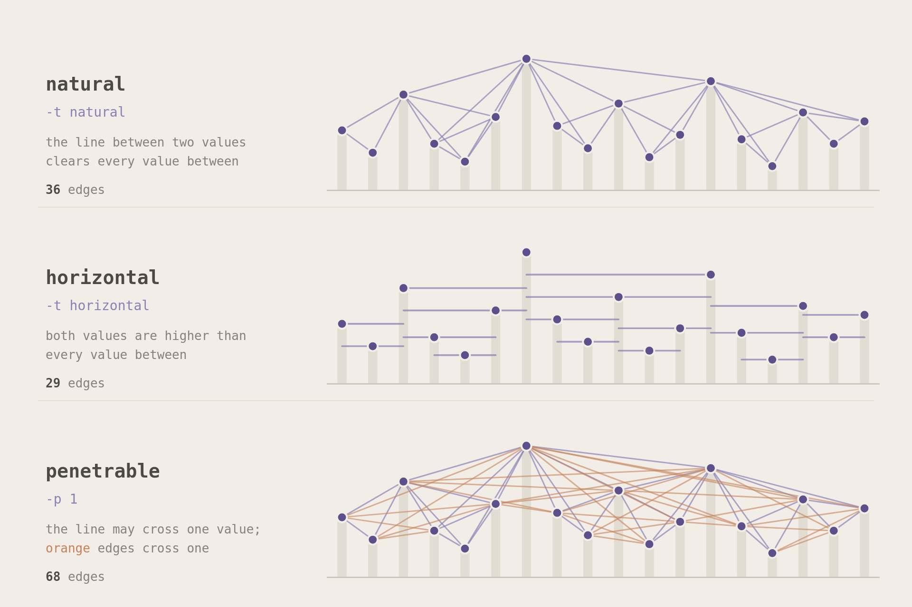
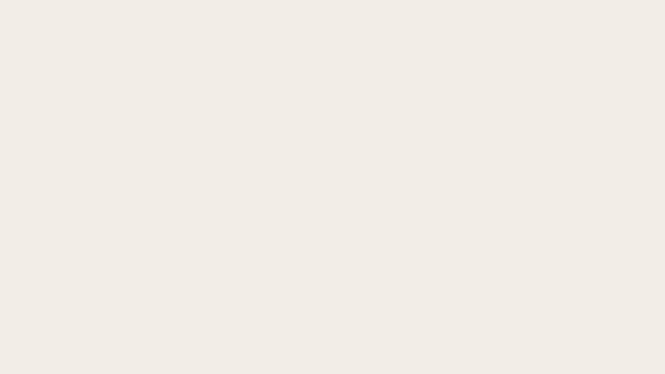

<p align="center"><picture><source media="(prefers-color-scheme: dark)" srcset="docs/art/banner-dark.gif"></picture></p>

bend-visgraph builds visibility graphs of time series in
[Bend2](https://github.com/bendlang/bend). It ports the graphs of
[ts2vg](https://github.com/CarlosBergillos/ts2vg) 1.2.4: natural and
horizontal, undirected or directed, limited penetrable or not, with any of
ts2vg's edge weights. Each sweep does ts2vg's operations in the same order,
in F32. With 64 threads, bend-visgraph builds the graphs of 1,000,000 values
17 to 76 times faster than ts2vg's `build`. It is on
[BendHub](https://hub.bend-lang.com/n/bend-visgraph) as `bend-visgraph`.

<p align="center">
  
</p>

## A series becomes a graph

Each value of a time series is a node of its graph. In the natural graph,
two values are linked when the straight line between them passes above
every value between them. A high value sees far in both directions, so the
highest values become the hubs. The horizontal graph asks more of the two
values: both must be higher than every value between them. A limited
penetrable graph lets the line cross up to `-p` values that would block it.

<p align="center">
  
</p>

ts2vg's options choose the graph, and bend-visgraph takes the same ones: `-d`
directs each edge left to right or top to bottom, and `-w` weighs it by a
distance, a slope, an angle or the number of values it crosses.

## Requirements

- [Bend](https://bend-lang.com) 2.0.37, which installs with
  `curl -fsSL https://bend-lang.com/install.sh | sh`. A native build needs
  clang 14 or newer.
- For the tests and the benchmark: [uv](https://docs.astral.sh/uv/), and
  [Bun](https://bun.sh) to run the JavaScript build.

bend-visgraph is tested on Linux x86-64.

## Use it

```sh
bend bend_visgraph.bend -o bend_visgraph
./bend_visgraph series.txt -t natural -w distance
```

The input is a text file with one value per line. The options are those of
ts2vg's command line, with the input first, and `-x`, which takes the `xs`
of ts2vg's `build`:

| Option | Values | Default |
| --- | --- | --- |
| `-t`, `--type` | `natural`, `horizontal` | `natural` |
| `-d`, `--directed` | `left_to_right`, `top_to_bottom` | undirected |
| `-w`, `--weighted` | `distance`, `sq_distance`, `v_distance`, `abs_v_distance`, `h_distance`, `abs_h_distance`, `slope`, `abs_slope`, `angle`, `abs_angle`, `num_penetrations` | unweighted |
| `-p`, `--penetrable_limit` | how many values an edge may cross | 0 |
| `-m`, `--outputmode` | `el` edge list, `ds` degree sequence, `dd` degree distribution, `dc` degree counts | `el` |
| `-o`, `--output` | a file | standard output |
| `-x`, `--xs` | a file with the x of each value, one per line, increasing | the index |

## Use it from Bend

`visgraph.bend` is the library, and BendHub serves it as
`bend-visgraph@2.0.0.0/visgraph.bend`. `VG.build(o, s)` returns the graph
of the series `s` with ts2vg's options `o`:

- `VG.Options{visibility, directed, weighted, min_weight, max_weight,
  penetrable_limit}` holds the options of ts2vg's graph classes:
  `VG.Natural{}` or `VG.Horizontal{}`; `VG.Undirected{}`,
  `VG.LeftToRight{}` or `VG.TopToBottom{}`; a weight such as
  `VG.Unweighted{}` or `VG.Distance{}`; the bounds on the weights, with
  `VG.neg_inf()` and `VG.inf()` as none; and how many values an edge may
  cross. `VG.options(VG.Natural{})` gives ts2vg's defaults.
- `VG.Series{n, ys, xs}` holds `n` values in an array, and their x as
  `VG.Index{}` or `VG.At{xs}`. `VG.series(values)` and `VG.series_at(xs,
  values)` make one from lists.
- `VG.Graph{n, directed, edges}` is the graph. `VG.fold(~A, ~f, g, acc)`
  folds the template `f(acc, src, dst, w)` over its edges, `VG.degrees(g)`
  gives ts2vg's degrees as an array, and `VG.adjacency(g)` gives its
  compressed rows, each in increasing order. A def that reads a graph more
  than once takes it as `+g`.

This program imports the library from BendHub and prints 4, the number of
edges:

```python
import Base
import bend-visgraph@2.0.0.0/visgraph.bend as VG

def main() -> IO(Unit):
  do IO<Unit>:
    g : VG.Graph = VG.build(VG.options(VG.Natural{}), VG.series([3.0, 4.0, 2.0, 1.0]))
    IO.print(U32.show(VG.fold(~U32, ~(m => s => t => w => (m + 1 : U32)), g, 0)))
```

`VG.build` runs the natural and horizontal graphs on one thread, and splits
the penetrable ones among every thread. `parallel.bend` builds every graph
on every thread: `Par.build` and `Par.degrees` take what `VG.build` and
`VG.degrees` take, and the command line uses them. Only `parallel.bend`
relies on Base's `@unsafe` `Array.fork`, so `bend --check-only` passes on a
program that does not import it, such as `tests/one_thread.bend` and
`tests/library.bend`.

```python
import bend-visgraph@2.0.0.0/visgraph.bend as VG
import bend-visgraph@2.0.0.0/parallel.bend as Par
```

Inside this repository, import `./visgraph.bend` and `./parallel.bend`
instead.

## Every value sweeps its own stretch

<p align="center">
  
</p>

ts2vg's divide and conquer takes the first highest value of an interval as
its pivot, sweeps the interval from it, and recurses on the two sides. Every
value is the pivot of one interval: the stretch where it is the highest. The
stretch starts after the nearest earlier value that is at least as high, and
ends before the nearest later value that is higher. bend-visgraph finds
every stretch before any sweep starts, so no sweep waits for another.

A stack finds the stretches. It runs on blocks of values in parallel, each
block with a stack of its own values. Three kinds of stretch can reach past
a block: that of a value higher than every earlier value of its block, that
of a NaN that opens the block, and that of a value still on the stack at the
block's end. A merge walks the blocks in order and closes them.
bend-visgraph then cuts the values into chunks of equal work, where the work
of a value counts the values its sweeps visit, and a fork tree of 512 leaves
runs the chunks. On 1,000,000 values there are 512 blocks and about 1,024
chunks. [How the build splits](docs/benchmark.md#how-the-build-splits) says
where the time goes.

A penetrable graph has no stretches to find: every value sweeps the values
right of it, and a natural sweep visits all of them. bend-visgraph splits the
start values into 128 ranges, of equal work for the natural graph and of
equal count for the horizontal one.

## It builds a million values 17 to 76 times faster

<p align="center">
  <picture><source media="(prefers-color-scheme: dark)" srcset="docs/art/speed-dark.gif"></picture>
</p>

On one thread, bend-visgraph builds every natural graph as fast as ts2vg's
Cython kernel (`only_degrees`) or faster: 2.5 times faster on the random
walk of 1,000,000 values. It takes about twice as long as the kernel on the
horizontal graphs of 100,000 values and more, whose sweep does only a
comparison per value. With 64 threads, bend-visgraph builds the graphs of
1,000,000 values 17 to 76 times faster than ts2vg's `build`. The limited
penetrable natural graph takes about 13% less time than ts2vg's kernel on
one thread, and 64 threads build it 42 times faster at 50,000 values. A
penetrable horizontal sweep stops early, so that graph has little work to
split, and ts2vg's kernel stays faster on it. Small series gain little: on
the natural and horizontal graphs of 10,000 values, 64 threads take longer
than 8. [docs/benchmark.md](docs/benchmark.md) has every time, the irregular
x runs, and the machine.

## Its edges are ts2vg's

The tests compare bend-visgraph with ts2vg. On every test series, its
unweighted edges equal ts2vg's, and its weights lie within 1e-6 relative.
`bench/compare.py` compares the large graphs of the benchmark: 24 of its 28
graphs are equal edge for edge. In the other 4, a few edges differ where
three values are nearly collinear, and every edge that only one tool has is
in the graph.

## Where it differs from ts2vg

- Bend2 has no float64, so bend-visgraph computes in F32. It rounds each value
  once from its text to F32, and so each x of `-x`. On the same F32 values,
  its unweighted edges equal ts2vg's on every test series. The two can
  differ where three values are nearly collinear, since F32 slopes carry 24
  bits.
- F32 holds every index below 2^24 exactly, so without `-x` the command
  line refuses a series of more than 16,777,216 values. The library's
  `build` does not check.
- F32 x carries 24 bits too: Unix times in seconds, about 1.7e9, round to
  multiples of 128. Subtract the first x before writing the file.
- Rounding a float64 series to F32 can tie values that differ in float64.
  For a series with a large offset, such as `1000 + 0.01 * noise`, subtract
  the offset before writing the file.
- Visibility depends only on differences of x and of values, but ts2vg's
  tolerance grows with their size. So where three values are nearly
  collinear, a shift can add or drop an edge, in ts2vg as in bend-visgraph.
- F32 overflows above about 3.4e38. A weight that overflows, such as the
  distance between values near 1e20, is infinite, and the default upper
  bound on weights then drops its edge, which ts2vg keeps.
- Edges come out in another order, and `-o` prints no summary.

## The parallel split is a law

<p align="center">
  
</p>

`LAWS.bend` states the rules of the parallel split, and `PROOF.bend` proves
each one in Bend. Each level of the fork tree halves its chunks without
losing or repeating one. The sweeps of two consecutive ranges of start
values give the edges of both ranges at once. The parallel penetrable build
gives the edges of one sequential pass over its start values, in the same
order, wherever it cuts them. F32 arithmetic is opaque to the checker, so
the laws state what holds for every F32 word. No law states the stretches
of the natural and horizontal builds; the tests check those.

## Check it

```sh
uv sync --locked
bend PROOF.bend
uv run pytest -n auto
```

`bend PROOF.bend` checks the proofs, and still prints SOME PROOFS FAIL,
naming the 13 defs of `parallel.bend` that rely on Base's `@unsafe`
`Array.fork`: the tasks that share a forked array read it, write cells no
other task writes, or add to cells atomically.

The tests build `bend_visgraph`, `tests/one_thread.bend` and
`tests/library.bend` natively and as JavaScript, and compare them, bit for
bit, with `tests/reference.py`, a float32 copy of ts2vg's kernels. They also
compare the native build with ts2vg itself: the unweighted edges must be
equal, and the weights within 1e-6 relative. On series of 100,000 values,
they compare the JavaScript build with the native one.

## License

MIT, in [LICENSE](LICENSE). bend-visgraph ports ts2vg's graph kernels, and
`tests/reference.py` copies them in float32, so the license carries ts2vg's
copyright notice too.
